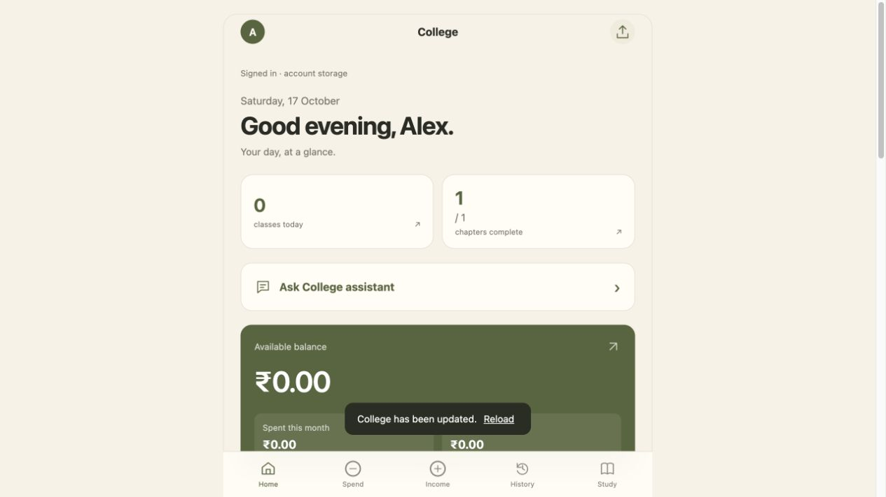
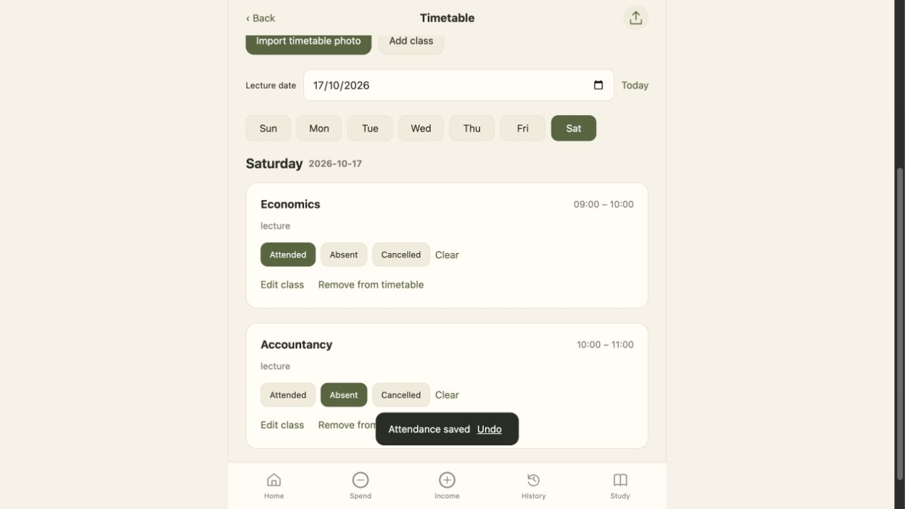

# College

### Spending, studies and attendance. One place for your college day.

Keep track of where your money goes, what you’re studying and which lectures you attend—with a personal timetable and a calm, mobile-friendly interface.

**[Open College →](https://jahaanali10.github.io/college-web/)** · [Report a bug or suggest a feature](https://github.com/jahaanali10/college-web/issues) · [Releases](https://github.com/jahaanali10/college-web/releases)

No installation required. Try device-only mode, or create an account to save your records online. New users start with an empty workspace—your subjects and timetable are your own.

## What you can do

| Your college day | What College helps you track |
| --- | --- |
| **Money** | Spending, income, weekly budgets, category breakdowns and weekly net gain or loss. |
| **Study** | Your own subjects and chapters, completed work, search and progress. |
| **Timetable** | Add classes manually or read a timetable photo, then review and correct the results. |
| **Attendance** | Mark lectures attended, absent or cancelled. See overall and subject-wise percentages. |
| **Your account** | Email sign-in, verification, password recovery and a personalised dashboard. |
| **Backups** | Export your records, preview an import and merge without duplicating matching entries. |

## A look inside

Screenshots below use sample records, not a real student’s personal data.

<table>
<tr><td align="center"><strong>Your dashboard</strong></td><td align="center"><strong>Timetable & attendance</strong></td></tr>
<tr><td></td><td></td></tr>
</table>

## Get started

1. **[Open College](https://jahaanali10.github.io/college-web/)** on your phone or computer.
2. Choose **Use on this device**, or create an account and confirm your email.
3. Add your own subjects and chapters in **Study → Manage subjects & chapters**.
4. Open **Study → Timetable**, add your classes or import a photo, and start marking attendance.
5. Add spending and income as you go. Keep a backup of your records.

On iPhone, open the site in Safari and choose **Share → Add to Home Screen**. Open the installed app online once to cache it for later use. Browser tabs and Home Screen apps can have separate storage, so import an existing backup inside the version you actually use.

## How attendance works

Attendance is **attended ÷ (attended + absent)**. Cancelled classes and breaks do not count. Today’s unmarked lectures show a reminder on Home; after local midnight, they become absent when the app is open or next reopened. This is an in-app reminder, not a background push notification.

Tracking starts when you first open the attendance-enabled version; it does not penalise earlier lectures. Marks stay editable. After a gap between visits, intervening dates use your saved weekly timetable—correct holidays or changed classes with the date picker.

## Your records, your choice

- **Device-only mode:** records stay in this browser’s local storage database. Open online once to enable offline use. Clearing website data or losing the device can remove these records.
- **Signed-in mode:** account records save to Supabase with user-specific access rules. An internet connection is required for editing; a previously cached account copy can be viewed offline. Choose **Load latest records** after editing on another device.
- **Existing users:** signing in does not silently upload your device records. Settings offers **Copy this device’s records into my account**, with a confirmation first.
- **Timetable photos:** OCR runs in the browser using Tesseract.js. Images are not uploaded for reading. Printed English works best; always check days, times and subjects before saving.

The built-in assistant currently gives direct answers from app records; it is not a general-purpose AI chatbot. The app does not require a paid AI API. Hosted services have their own availability and usage limits.

Personal records, passwords, secret API keys and backup exports do not belong in this public repository. Keep regular exported backups. The native iPhone app remains separate; records do not automatically move between it and the web app.

## Run locally

This is a static HTML/CSS/JavaScript app with no build step.

```sh
python3 -m http.server 4173
```

Open [http://localhost:4173](http://localhost:4173). Use a local HTTP server rather than opening `index.html` directly. Device-only mode works without configuring a backend. The included account configuration points to the hosted College project; use your own Supabase project and database policies for a separate deployment. A publishable key can be public; database passwords, secret keys and service-role keys must stay private.

The app shell is cached by a service worker. When publishing app changes, update the versioned assets and cache list together. App updates replace cached files without clearing the records database.

## Feedback welcome

Found a timetable the reader struggles with, or something that would make student life easier? **[Open an issue](https://github.com/jahaanali10/college-web/issues)** with the steps and expected result. Use sample data and remove personal information from screenshots.

If College is useful to you, a star helps other students find the project.

### Exams and portion

Open **Study → Exams & portion**. New and existing accounts start with an empty exam list until they add subjects or import a schedule. Each exam subject has its own date, times, editable topic list and completion checkboxes. Matching chapters completed in Study also update exam portion; subjects and titles are matched conservatively. Account storage, offline copies and export/import backups include these records.

**Add code → `MITHIBAI-SYJC-TERM1-2026`** previews the Mithibai SYJC October 2026 first terminal schedule for Commerce with Secretarial Practice and IT, including the published portion. This is an optional public preset, not a private access code. Imports keep existing records and do not duplicate the same preset IDs.

The assistant reads saved exam records for dates, upcoming papers, days remaining, portions and unfinished topics. It remains an offline answer system, with no model or paid API calls. Each question is independent; suggested study order follows exam dates and unfinished topics, not predicted marks or difficulty.

Run the exam regression checks with `node --test tests/exams.test.mjs`.

### Study and timetable setup codes

Study, Timetable and Exams & portion each have **Add code** and **Create code** controls. New short codes use the existing Supabase project and need internet access. Older long codes contain the setup itself and remain importable offline. Preview before merging. Study and exam codes exclude completion marks; timetable codes exclude attendance. No finances, account details or chats are included. Timetable imports reject overlaps; repeated imports skip existing topics/classes. The optional `MITHIBAI-SYJC-TERM1-2026` code also imports the terminal topics into Study when explicitly selected there; it is not a full-year syllabus.

Exam topics are collapsed under **View portion** by default. The dropdown remains open while marking topics, and resets when the user switches accounts.

### User-chosen short codes

The short-code feature lets signed-in users choose an available 4–32 character code, such as `COMMERCE-A`. Run `supabase/setup-short-codes.sql` once in the existing Supabase project when setting up a new Supabase project. This creates separate shared-setup storage and two narrowly scoped functions. Existing account data is not changed. Creation requires authentication; exact-code lookup is available to anyone. Codes hold snapshots of the explicitly shared subjects/chapters or class timetable or exam dates/portion, not personal progress or finances. Codes are case-insensitive, cannot overwrite existing codes, and are limited to 25 per account. Legacy long codes and the built-in terminal preset remain importable. Short codes require internet access. The existing project has the database setup activated.

### Public code library

Use **Browse public codes** in Study, Timetable or Exams to search published setups, filter their type and preview/import a copy. Guests can browse and import. Signed-in creators can publish an existing code with a title and description, edit their listing or unlist it. Older codes remain unlisted until their creator explicitly publishes them. Unlisting removes discovery, while the original exact code and previously imported copies remain available. Public snapshots exclude marks and chapter completion; account records are never listed.

Database setup: run `supabase/setup-short-codes.sql` first, then `supabase/setup-code-market.sql`. The catalog exposes only listing metadata, never owner identifiers. All creation/edit/unlist operations check the signed-in owner on the server.

### Exam space

The exam dashboard highlights the next upcoming paper, dates and portion progress. Sections collapse to keep the schedule compact; search and All/Upcoming/Done/Results filters narrow the list. Mark each paper done independently of preparation, and use Add marks/Edit marks to save obtained and maximum marks. Recorded percentages include only entered results. Completion and marks survive account saves/backups, and are excluded from shared setup codes.
